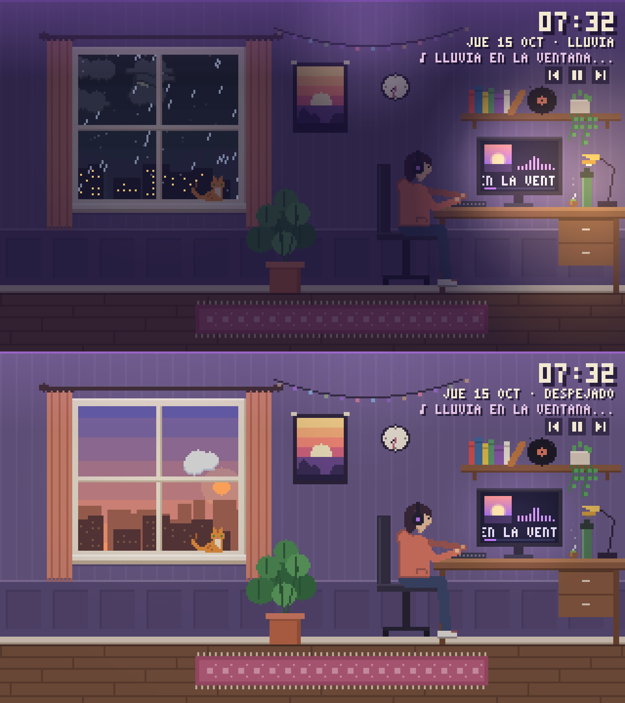

# cuartito

Un cuarto lofi en pixel art que vive con vos. Es un wallpaper animado para **Wallpaper Engine** y **Lively Wallpaper**.

**[Vista previa en el navegador](https://bridemirci.github.io/cuartito/)** · **[Descargar](https://github.com/BriDemirci/cuartito/releases/latest)**

## Qué hace

- **Clima real:** por la ventana se ve el clima de tu ciudad (sol, nubes, lluvia, tormenta con rayos, nieve o niebla). La nieve se va juntando en el alféizar y las gotas resbalan por el vidrio.
- **Hora real:** amanece, se hace de día, atardece y anochece según la salida y la puesta del sol de tu ciudad. De noche aparecen las estrellas, la luna con su fase real y las luces de los edificios.
- **Tu música:** en el monitor se ve la canción que suena con su portada, y las luces del cuarto toman el color de la portada y laten con el audio. La persona cabecea al ritmo.
- **El gato:** baila cuando hay música, duerme la siesta, y si le hacés clic te dice su nombre y le salen corazones. Si instalás el ayudante, se eriza cuando la PC está exigida.
- **Vida propia:** la persona toma mate, se estira, programa cuando no hay música y, de madrugada y sin música, se queda dormida.
- **La lámpara:** se prende sola cuando oscurece, y la podés prender o apagar con un clic.

## Instalarlo

1. Descargá `cuartito.zip` de la [última versión](https://github.com/BriDemirci/cuartito/releases/latest) y descomprimilo.
2. Según el programa que uses:
   - **Wallpaper Engine:** abrí el editor, elegí *Abrir wallpaper* y después la carpeta `cuartito`. O copiá la carpeta en `steamapps/common/wallpaper_engine/projects/myprojects/`.
   - **Lively Wallpaper:** arrastrá el `.zip` a la ventana de Lively.
3. Para ver la canción que suena:
   - En **Wallpaper Engine**, activá *Configuración → General → Integración multimedia*.
   - En **Lively** ya viene activada.
4. En las opciones del wallpaper escribí tu **ciudad** para que el clima sea el real. Si hay más de una ciudad con ese nombre, agregá el país, por ejemplo `Córdoba, Argentina`.

### Ayudante opcional: botones de música y estado de la PC

Los wallpapers web pueden *ver* qué canción suena, pero no la pueden controlar, y tampoco pueden leer la CPU. Para eso está el ayudante de la carpeta `controles`:

- **`instalar.bat`:** lo arranca ahora y cada vez que prendés la PC. Aparecen los botones ⏮ ⏯ ⏭ debajo de la hora y el gato empieza a reaccionar a la CPU.
- **`iniciar.bat`:** lo arranca solo esta vez.
- **`desinstalar.bat`:** lo cierra y lo saca del inicio.

Es un script de PowerShell que escucha solo en `localhost:8978`. Aprieta las teclas multimedia de Windows y lee el uso de CPU y RAM, nada más. Las páginas web no lo pueden usar. Como es un script descargado, Windows puede mostrar un aviso de SmartScreen.

## Opciones

| Opción | Qué hace |
| --- | --- |
| Ciudad | De dónde se toma el clima y la hora de salida y puesta del sol |
| Clima | Real, o siempre despejado, nublado, lluvia, tormenta, nieve o niebla |
| Hora del día | Real, o siempre mañana, día, atardecer o noche |
| Gato | Naranja, negro, gris, blanco o siamés, y su nombre |
| Color del buzo | El que más te guste |
| Color de las luces | Según la portada de la canción, arcoíris o un color fijo |
| Información | Hora, fecha, clima y canción arriba a la derecha, en formato 12 o 24 horas, en °C o °F |
| Sensibilidad al audio | Para que las luces y el cabeceo reaccionen más o menos |

## Privacidad

Lo único que sale de tu PC es el nombre de la ciudad, que va a [Open-Meteo](https://open-meteo.com/), un servicio gratis y sin registro, para saber el clima. Nada más se envía a ningún lado.

## Apoyar el proyecto

Si te gusta y querés invitarme un café, pronto va a estar el link acá. ☕

## Licencia

[MIT](LICENSE). Los datos del clima son de [Open-Meteo](https://open-meteo.com/) (CC BY 4.0).
